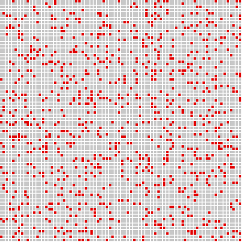
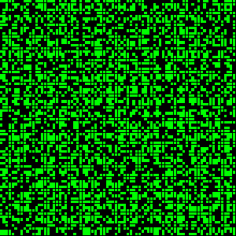
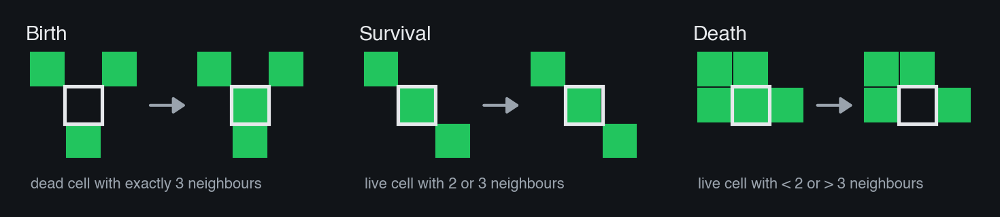
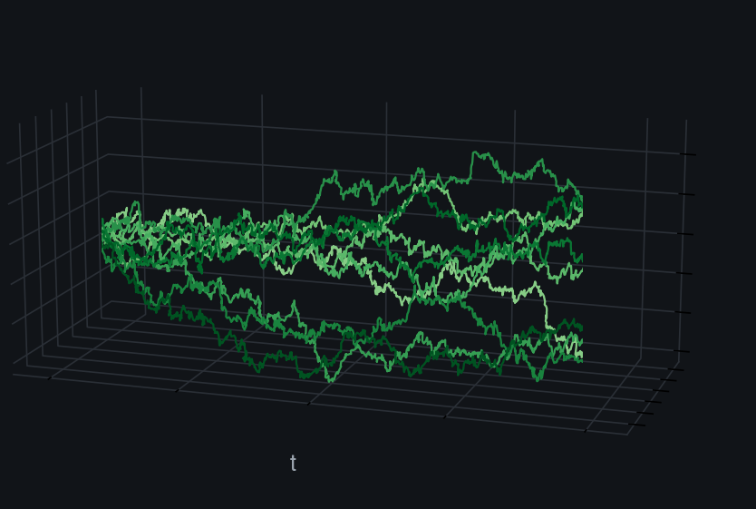

# Cellular Automata & Others

Conway's Game of Life written three times: Python, C++ with SFML, and C++ with raylib in 3D. Plus a few stochastic-process visualisations built on the same 3D setup.

<table>
  <tr>
    <td align="center"><b>Python · pygame</b></td>
    <td align="center"><b>C++ · SFML</b></td>
    <td align="center"><b>C++ · raylib 3D</b></td>
  </tr>
  <tr>
    <td></td>
    <td></td>
    <td></td>
  </tr>
</table>

## The rules



Every generation, each cell counts its 8 neighbours and the whole grid updates at once.

## Brownian motion in 3D



Ten random walks, each step drawn from N(0, dt), plotted along the time axis. It runs in raylib, so you can fly around the paths with the mouse and W A S D.

## Run

**C++** needs SFML and raylib (`brew install sfml raylib`).

```bash
cd cpp && make
./build/life_2d              # 2D Game of Life
./build/life_3d              # 3D view: mouse + W A S D to fly around
./build/brownian_motion_3d   # Brownian paths in 3D
./build/normal_dist_3d       # samples from a normal distribution, binned in 3D
```

**Python** needs `pygame` (plus `numpy` and `matplotlib` for the stochastic scripts).

```bash
python python/life_pygame.py
```

## Structure

```
cpp/
  apps/       one file per program (life_2d, life_3d, record_*, brownian_motion_3d, normal_dist_3d)
  src/        Game of Life rules, Brownian motion, 3D helpers
  include/    headers
python/
  life.py, life_pygame.py, record_gif.py
  stochastic/   Brownian motion and normal-distribution prototypes
  experiments/  OpenGL cube, 3D tensor automaton, neural-net grid (work in progress)
media/        GIFs and figures used above
```

`record_2d`, `record_3d` and `record_gif.py` save the frames behind the GIFs.
